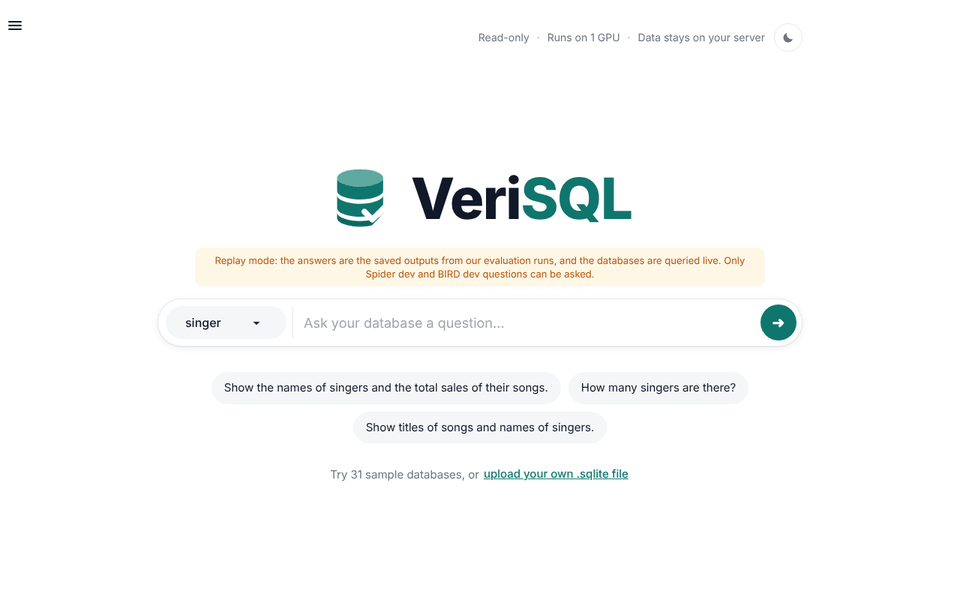
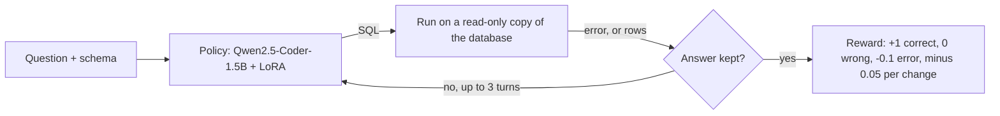

# VeriSQL

**Ask your database a question in plain English. VeriSQL writes the SQL, runs it, and checks its own answer.**

A small open model (Qwen2.5-Coder-1.5B-Instruct with a LoRA adapter) trained with reinforcement learning,
where the database itself is the judge. It runs on a single NVIDIA T4 next to your data, opens every
database read-only, and fixes its own query when the database reports an error.

<p align="center">
  
</p>
<p align="center"><sub>The real self-check loop on a Spider dev question: the first query fails (<code>no such column</code>),
the model reads the error, fixes the join and keeps the result after checking it. Recorded in replay mode
(<code>verisql/app.py --replay</code>, the model's saved outputs from our evaluation run, databases queried live).</sub></p>

UTS 43008 Reinforcement Learning, Project 56 (team Relative Advantage).

## Results

| | Spider dev | BIRD dev |
|---|---|---|
| Untrained model | 65.2% | 29.1% |
| DPO | 62.7% | 27.8% |
| GRPO | 74.6% | 36.1% |
| **RLOO** | **75.6%** | **37.0%** |

Execution accuracy with the official Spider and BIRD evaluation scripts. GRPO and RLOO beat the untrained
model on every benchmark (p < 0.0001) and are statistically tied with each other; offline DPO does not help.

**Self-checking (Phase 2).** Trained inside a multi-turn environment, the model learns when to change its
answer: over both methods, correct answers broken by the feedback fell from **13 to 1 on Spider dev**
(p = 0.002) and **20 to 1 on BIRD dev** (p < 0.0001). The self-checking GRPO model (MT-GRPO) is the most
accurate model on BIRD after feedback (36.5% strict EX).

Every number, with confidence intervals, significance tests and the file it comes from, is in
**[RESULTS.md](RESULTS.md)**.

## How it works



- **Reward from execution.** The query is run and its result compared with the result of the hidden gold
  query: +1 if it matches, 0 if it runs but is wrong, -0.1 if it fails. No learned reward model.
- **Phase 1 (single turn).** One query per question. We compared offline DPO with two online
  policy-gradient methods, GRPO and RLOO, using the same model, data, LoRA setup and GPU.
- **Phase 2 (multi-turn).** The model sees the database's reply (the error, or the first rows) and can
  keep or fix its query, for up to 3 turns. GRPO and RLOO were trained in this environment with the same
  update as TRL 0.24.

## Repository

| Folder | What is in it |
|---|---|
| [`text2sql-rl/`](text2sql-rl/) | Phase 1: data preparation, reward, DPO / GRPO / RLOO training, evaluation, the Gradio demo ([README](text2sql-rl/README.md)) |
| [`text2sql-rl/proof/`](text2sql-rl/proof/) | Proof of training for the three Phase 1 runs (step logs, checkpoint states, GPU, library versions) |
| [`text2sql-rl/evaluation/`](text2sql-rl/evaluation/) | Phase 1 results, official evaluation output, statistics, every prediction |
| [`extension/`](extension/) | Phase 2: multi-turn environment, trainer, evaluation, statistics, error and DPO analysis ([README](extension/README.md)) |
| [`extension/proof/`](extension/proof/) | Proof of training for the two multi-turn runs |
| [`verisql/`](verisql/) | `core.py`: the self-check loop, SQL guardrails and model engines; `app.py`: the Gradio demo ([README](verisql/README.md)) |
| [`service/`](service/) | FastAPI service: `POST /query`, health, metrics, JSON logs |
| [`eval/`](eval/) | Fixed 50-question eval set with its databases, and the evaluation runner |
| [`tests/`](tests/) | Guardrails, self-check loop, API contract, replay = original evaluation (run in CI) |
| [`deploy/`](deploy/) | Builds the Hugging Face Space and the Hub model repo ([README](deploy/README.md)) |
| [`docs/team-notes/`](docs/team-notes/) | The team's working notes and run plans |

## Run it as a service

```bash
docker build -t verisql . && docker run --rm -p 8000:8000 verisql     # then open http://localhost:8000/docs

curl -s localhost:8000/query -H 'content-type: application/json' \
  -d '{"question": "Show the names of singers and the total sales of their songs.", "db": "singer"}'
```

The response has the final SQL, the rows, and every self-check turn (the first query fails with
`no such column: s.Sales`, the model fixes it, then keeps it). Without a GPU the image uses the **replay
engine** (the model's saved outputs from our evaluation, databases queried live). For the real model set
`VERISQL_ENGINE=live` and point `VERISQL_ADAPTER` at a checkpoint or the Hub repo
([`ayv443/verisql-adapters`](https://huggingface.co/ayv443/verisql-adapters)); it uses CUDA, Apple MPS or
the CPU, in that order.

**Guardrails** (`verisql/core.py`): only SELECT/WITH statements, a read-only connection, a SQLite authorizer
that denies writes, ATTACH and PRAGMA, one statement per call, a 5 s timeout and a 100,000-row cap. Clients
name a database; they never send a path. **Logs** are one JSON line per request and per query (turns,
generation and SQL time); `GET /metrics` gives the failure rate and latency percentiles.

**Evaluation and CI.** `eval/run_eval.py` runs a fixed random sample of 50 Spider dev questions (databases
included in the repo) through the same loop. GitHub Actions runs the tests, the eval with the replay engine
as an accuracy gate (it must reproduce the recorded 66.0% exactly), and a container smoke test, all on CPU.

## Quick start (training and research code)

On a machine with an NVIDIA T4 (we used AWS SageMaker Studio, ml.g4dn):

```bash
cd text2sql-rl
pip install -r requirements.txt vllm==0.10.2 gradio pandas scipy matplotlib
bash download_data.sh            # Spider, Spider-Syn / DK, BIRD dev, official evaluation repos
python prepare_data.py           # filtering, validation split, prompts, cached gold results
python reward.py --split val     # sanity check: gold vs gold must give 1.000

# train (one run per GPU)
python train_rl.py --method rloo --seed 0 --max_steps 600 --lr 5e-5

# evaluate and compare
python evaluate.py --split spider_dev --tag rloo --adapter outputs/rloo-1.5b-s0/checkpoint-600

# Phase 1 demo: four models side by side
python app.py --dpo <dpo adapter> --grpo <grpo adapter> --rloo <rloo adapter>
```

The VeriSQL demo (the self-checking model) runs from the repository root:

```bash
python verisql/app.py --verisql <mt-grpo-1.5b-s0/checkpoint-150> --dpo <dpo adapter> --rloo <rloo adapter> --share
python verisql/app.py --replay     # no GPU: saved answers from the evaluation runs
```

The Phase 2 commands are in [`extension/README.md`](extension/README.md). The trained adapters are not in
the repository (too large).

## Team and my contribution

A three-person team project: Aditya Verma, Eby Kurian and Pravicksha Paulsamy Vigneshkumar.

**My part (Aditya Verma):**
- Trained the RLOO model (Phase 1), the best single-turn model on both benchmarks.
- Built the multi-turn environment (execution feedback, keep-or-fix decision, turn penalty) and its
  GRPO / RLOO training loop, matched to TRL's update, and ran the multi-turn RLOO training.
- Built the VeriSQL demo app.
- Did the error analysis, the DPO likelihood-displacement analysis and the significance tests for the
  multi-turn results.
- After the course: the production layer in this repo (FastAPI service, guardrails, eval suite, tests,
  Docker, CI, Hugging Face deployment).

## Licence

Code: MIT (see [LICENSE](LICENSE)). The datasets (Spider, Spider-Syn, Spider-DK, BIRD) and the base model
keep their own licences; they are downloaded by `download_data.sh` and are not part of this repository.
